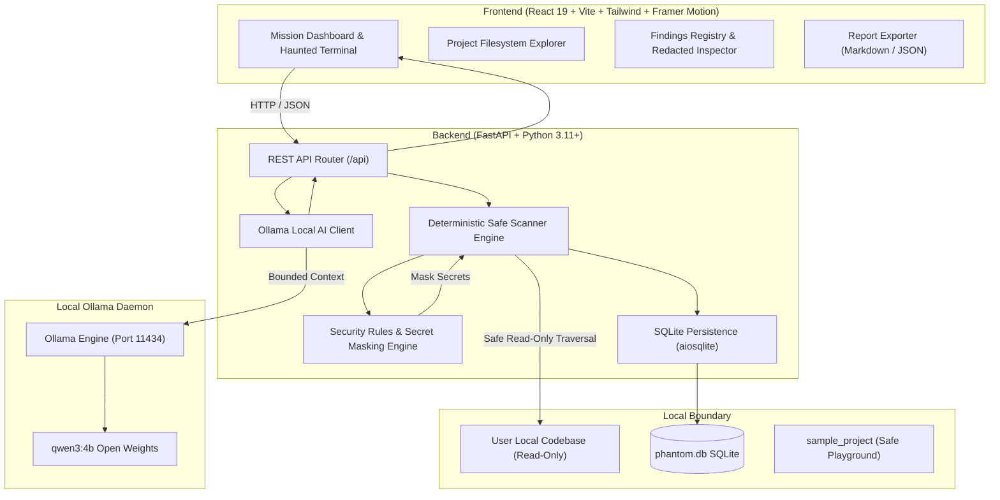

# PHANTOM — The AI That Haunts Your Terminal 👻

> **"THE MACHINE HAS AWAKENED."**  
> A local-first AI coding investigator that inhabits your computer, hunts for exposed secrets, security hazards, and code anomalies, and explains every finding through a cinematic haunted-terminal interface.

[](https://opensource.org/licenses/MIT)
[](https://www.python.org/)
[](https://fastapi.tiangolo.com)
[](https://react.dev/)
[](https://ollama.com/)

Submitted for the open-source AI challenge: **"Ghost in the Machine"**.

---

## 🌟 Highlights

- **Local-First & Private**: 100% of codebase scanning and AI inference runs locally. Zero code or tokens leave your machine.
- **Cinematic Haunted Terminal**: A colorful, Halloween-inspired cyber-gothic interface featuring deep midnight (`#070511`), violet, electric purple, neon green, cyan, and crimson glows with subtle scanlines, glassmorphism, and floating spectral animations.
- **Deterministic Security Heuristics**: Conservative pattern matching for exposed AWS keys, GitHub PATs, Stripe keys, private cryptographic keys, hardcoded passwords, dangerous `eval()`, insecure deserialization (`pickle.loads`), and live `.env` files.
- **Strict Secret Redaction**: Discovered sensitive values are safely masked (`***REDACTED***`) in memory before reaching the database, logs, or UI.
- **Supernatural Open-Weight AI**: Powered by local Ollama running `qwen3:4b` (or configurable models) with bounded prompt context and prompt injection defense.
- **Interactive Haunted Console**: Built-in terminal CLI supporting commands (`help`, `status`, `scan`, `findings`, `history`, `model`, `clear`, `why-open-ai`) and natural-language queries.
- **Persistent SQLite Memory**: Stores investigation history, severity distributions, finding resolution statuses, and scans comparison (scan diff).
- **Exportable Dossiers**: Instant Markdown (`.md`) and JSON (`.json`) report generation with redacted evidence and security limitations notice.
- **Safe Playground Included**: Contains a pre-built `sample_project` with synthetic, harmless test vulnerabilities.

---

## 🏗️ Architecture



---

## 📸 Screenshots

> **Note for Evaluators**: Follow the startup instructions below to run PHANTOM locally. Capture screenshots of:
> 1. **Mission Dashboard**: The glowing hero section ("THE MACHINE HAS AWAKENED"), stat cards, and AI connection status.
> 2. **Investigation Results**: The interactive Project Directory Tree, language breakdown, and findings table.
> 3. **Anomaly Detail Modal**: The safely redacted evidence snippet and containment remedy.
> 4. **Haunted AI Console**: The terminal interface answering natural language security queries.
> 5. **Scan Comparison Diff**: The historical comparison between two scans.

Save captured screenshots in the `docs/screenshots/` folder.

---

## 🧰 Technology Stack

- **Frontend**: React 19, TypeScript, Vite, Tailwind CSS, Framer Motion, Lucide React, Recharts.
- **Backend**: Python 3.11+, FastAPI, Uvicorn, Pydantic, aiosqlite.
- **Database**: SQLite (local persistence at `backend/data/phantom.db`).
- **AI Engine**: Local Ollama (default: `qwen3:4b` or `qwen3:0.6b`), HTTP API integration.
- **Testing**: pytest & pytest-asyncio (Backend), Vitest (Frontend).

---

## ⚙️ Prerequisites

1. **Python 3.11+** installed (`python --version`)
2. **Node.js v18+** with npm (`node --version`, `npm --version`)
3. **Ollama** installed and running locally ([Download Ollama](https://ollama.com))

---

## 🚀 Quickstart Guide (Windows PowerShell)

### Step 1: Clone the Repository
```powershell
cd "$HOME\Desktop"
git clone https://github.com/your-username/phantom.git
cd phantom
```

### Step 2: Launch Ollama and Pull the Model
In a PowerShell window:
```powershell
# Start Ollama service (if not already running)
ollama serve

# In another terminal window, download the default model:
ollama pull qwen3:4b
```
*(Optional for faster CPU performance: `ollama pull qwen3:0.6b`)*

### Step 3: Install & Start Backend
Open a PowerShell terminal in the project root:
```powershell
# Create Python virtual environment
python -m venv backend/.venv

# Activate virtual environment
.\backend\.venv\Scripts\Activate.ps1

# Install backend dependencies
pip install -r backend/requirements.txt

# Run backend unit test suite (15 tests)
$env:PYTHONPATH="."; pytest backend/tests

# Start FastAPI server on port 8000
$env:PYTHONPATH="."; python -m uvicorn backend.app.main:app --host 127.0.0.1 --port 8000 --reload
```
Backend API will be live at: **http://127.0.0.1:8000**  
API Documentation (Swagger): **http://127.0.0.1:8000/docs**

### Step 4: Install & Start Frontend
Open a **second** PowerShell terminal in the project root:
```powershell
cd frontend

# Install frontend dependencies
npm.cmd install

# Run frontend tests
npm.cmd test

# Start Vite development server
npm.cmd run dev
```
Frontend Web Application will be live at: **http://localhost:5173**

---

## 🐧 Quickstart Guide (macOS / Linux)

```bash
# Backend
python3 -m venv backend/.venv
source backend/.venv/bin/activate
pip install -r backend/requirements.txt
PYTHONPATH="." pytest backend/tests
PYTHONPATH="." python3 -m uvicorn backend.app.main:app --host 127.0.0.1 --port 8000 --reload

# Frontend (in another terminal)
cd frontend
npm install
npm test
npm run dev
```

---

## 🧪 Testing a Real Investigation

1. Open **http://localhost:5173** in your browser.
2. In the hero section, click **"Load Safe Sample Project"** or click **"Begin Investigation"**.
3. Target workspace is automatically set to `./sample_project`.
4. Click **"Start Investigation"**:
   - The recursive scanner inspects the sample files.
   - Deterministic rules detect 2 Critical anomalies (Stripe live key, AWS key ID), 4 High anomalies (`eval`, pickle, exposed `.env`, hardcoded password), and 2 Medium anomalies (`DEBUG=True`, `subprocess(shell=True)`).
   - Sensitive credentials in the evidence preview are masked (`STRIPE_KEY=sk_***REDACTED***78`).
   - Local Ollama generates an eerie executive summary.
5. Click **"Inspect"** on any finding to view detailed containment advice.
6. Click **"Chat in Terminal"** or navigate to **AI Console** to query PHANTOM about remedies.
7. Click **"Export Report"** to download the sanitized Markdown or JSON dossier.

---

## 📜 Arcane Terminal Commands

Inside the in-browser **Haunted AI Console**:

| Command | Action |
| :--- | :--- |
| `help` | Reveal all supernatural commands and sample prompts |
| `status` | Query Ollama connection, active model, and system vital signs |
| `scan` | Initiate an immediate codebase surveillance scan |
| `findings` | List all anomalies unearthed in the current investigation |
| `history` | Query persistent SQLite archives of previous investigations |
| `model` | Inspect local open-weight model catalog |
| `why-open-ai` | Display open innovation philosophy & privacy rationale |
| `clear` | Purge terminal scrollback history |

---

## 🛡️ Security & Privacy Notice

- **Non-Destructive**: PHANTOM performs read-only inspection. It never automatically modifies, deletes, or uploads files.
- **Zero Cloud Leakage**: No telemetry, analytics, or source code are transmitted over the internet.
- **Path Traversal Protection**: Attempts to scan system-critical directories (`C:\Windows`, `C:\`, `/etc`) are blocked.
- **Educational Notice**: PHANTOM provides deterministic pattern-based anomaly detection. It does not replace a comprehensive manual security audit.

---

## 📄 License

Licensed under the [MIT License](LICENSE).
Open-weight models accessed via Ollama operate under their respective licenses (e.g. Apache 2.0 / Qwen Research License).
