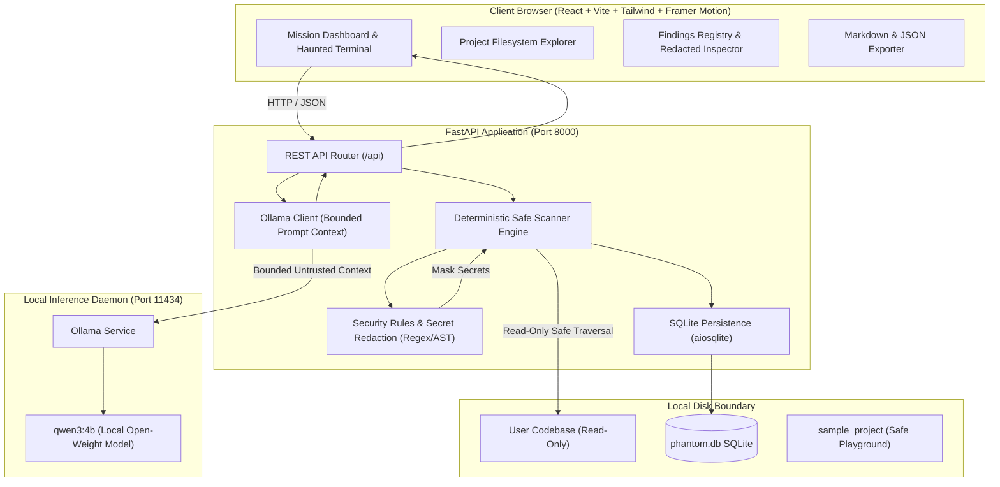

# PHANTOM Architecture & System Design 👻

PHANTOM is designed with a strict **local-first, read-only security boundary**. It separates deterministic code inspection from probabilistic open-weight LLM interpretation.

## High-Level Architecture

## Security & Isolation Pillars

1. **Path Traversal Protection**: All paths are resolved with `Path.resolve()` and validated against system-critical roots (`C:\Windows`, `C:\`, `/etc`, `/usr`).
2. **Read-Only Scanner**: Scans inspect file text into memory without writing, deleting, or modifying user files.
3. **Secret Redaction**: Discovered keys (AWS, GitHub, Stripe, Slack, Private Keys) are replaced with `***REDACTED***` in memory before reaching the database, logs, or UI.
4. **Prompt Injection Defense**: Scanned code is treated as untrusted user input wrapped inside `<untrusted_investigation_evidence>` XML boundaries with strict system directives instructing the local LLM never to follow instructions found within scanned files.
5. **Zero Cloud Telemetry**: All analysis runs completely on `127.0.0.1`.
